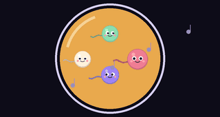
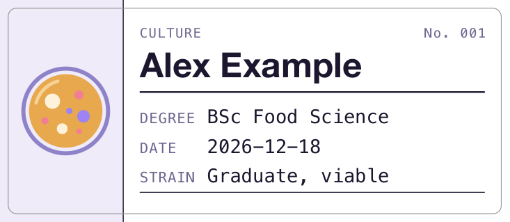

# T-Display S3 Message Display

A desk display that receives messages, photos and animated GIFs over the internet, built on a **LILYGO T-Display S3** (ESP32-S3, 320 × 170 screen). It was made as a graduation gift for a food-science graduate, so the whole interface is themed around a petri dish: colonies grow on screen as messages arrive.

<p>
  
  
</p>

## Features

- **Clock and weather.** A large clock with a blinking colon, the date, and current weather from [Open-Meteo](https://open-meteo.com/). There's also a weather screen with the day's high and low.
- **Messages from anywhere.** Text is sent through an MQTT broker over TLS, so the display works on any Wi-Fi with no port forwarding. Greek and other UTF-8 text is supported, the inbox keeps 10 messages, and an unread badge shows on the clock.
- **Animated GIFs and photos.** The web control page resizes GIFs to fit the screen and turns JPG/PNG/WebP photos into dithered GIFs in the browser. It sends them to the device in CRC-checked chunks (up to 4 MB). GIFs are decoded from PSRAM.
- **The Culture screen.** A living petri dish with one colony for every message ever received. Colonies spiral outwards, gently "breathe", and a new one pops in with a ripple when a message arrives. The display switches to this screen after 5 minutes without a button press.
- **Messages from friends.** A separate page, [`web/tdisplay-messages.html`](web/tdisplay-messages.html), lets friends send a note with their name ("Anna · 20:31"). Their messages use their own topic, and the display only ever shows what arrives there as text, so a friend's login can never change settings or install software.
- **Remote control.** Change brightness, night dimming hours, 12/24-hour time, weather location and which screens are shown, all from the control page.
- **Firmware updates over MQTT, confirmed on the device.** New firmware is sent the same way as GIFs and checked with a CRC-32, then waits in PSRAM: it is installed to the spare app partition only after someone presses the upper button on the display within 60 seconds.
- **Easy setup for whoever receives it.** If no known Wi-Fi is found, the device opens a setup hotspot with a captive portal. Phones open the setup page by themselves, and the chosen network is saved to flash.
- **Survives restarts.** Messages and the current animation are saved to LittleFS, and settings to NVS.

## How it works

```text
Owner: web/tdisplay-control.html      Friends: web/tdisplay-messages.html
   │  radio/inbox (everything)            │  radio/messages (text only)
   └──────────────┬───────────────────────┘  MQTT over secure WebSocket
                  ▼
MQTT broker (TLS, one login per person, deny-by-default rules)
   │  MQTT over TLS            ▲ radio/status (replies)
   ▼                           │
T-Display S3 ── LittleFS (messages, GIF)
             ── NVS (settings, Wi-Fi, colony count)
             ── Open-Meteo (weather, HTTPS)
```

- **Drawing:** every screen is drawn into a full-screen 16-bit sprite in PSRAM with TFT_eSPI's anti-aliased primitives, then pushed in one go. Screens slide in with an eased transition.
- **Fonts:** [M PLUS Rounded 1c](https://fonts.google.com/specimen/M+PLUS+Rounded+1c), converted by [`firmware/tools/make_fonts.py`](firmware/tools/make_fonts.py) into TFT_eSPI smooth-font arrays with only the glyphs needed (ASCII, Greek, a few symbols).
- **Security:** each person gets their own broker login with the narrowest rights, and software updates need a button press on the device. See [`docs/SECURITY.md`](docs/SECURITY.md) for the account setup.
- **Background work:** the GIF download, MQTT connection, weather and web server run in their own FreeRTOS tasks, so the buttons and screen stay responsive.

## Repository layout

| Path | What's there |
|---|---|
| [`firmware/`](firmware/) | PlatformIO project (Arduino framework) |
| [`firmware/src/gift_config.h`](firmware/src/gift_config.h) | All personal text in one place: name, degree, preloaded messages, setup hotspot name |
| [`firmware/tools/`](firmware/tools/) | Python generators for the fonts, the GIF pack and the printable label and card |
| [`web/tdisplay-control.html`](web/tdisplay-control.html) | The control page: a single HTML file with no build step or server, including its own MQTT client and GIF encoder |
| [`web/tdisplay-messages.html`](web/tdisplay-messages.html) | The friends' page: name, login and a text box; can only send text messages |
| [`docs/SECURITY.md`](docs/SECURITY.md) | Which broker accounts to create and what each may do, in plain language |
| [`gifs/`](gifs/) | Six animations drawn in code, sized for the screen |
| [`print/`](print/) | A 60 × 25 mm "culture label" sticker and an 85 × 55 mm how-to card (SVG and PDF, with bleed and cut lines) |



## Getting started

You need a LILYGO T-Display S3, [PlatformIO](https://platformio.org/), and an MQTT broker with TLS and WebSocket support. The free tier of [EMQX Cloud](https://www.emqx.com/en/cloud) works.

1. **Point the firmware at your broker.** Set `MQTT_HOST` in [`firmware/src/app_config.h`](firmware/src/app_config.h). If your broker uses a different certificate authority, replace the CA certificate in `firmware/src/mqtt_service.cpp`.
2. **Add your credentials:**
   ```sh
   cd firmware
   cp include/secrets.example.h include/secrets.h   # then fill in Wi-Fi and broker login
   ```
   `secrets.h` is git-ignored.
3. **Personalise** [`gift_config.h`](firmware/src/gift_config.h) (or leave the examples).
4. **Build and upload:**
   ```sh
   pio run -t upload
   ```
5. **Set up the broker accounts** as described in [`docs/SECURITY.md`](docs/SECURITY.md): one for the display, one for you, one per friend, everything else denied.
6. **Open the control page:** open `web/tdisplay-control.html` in a browser, enter the broker's WebSocket address and your owner login, and connect. Friends use `web/tdisplay-messages.html` with their own login.

### Buttons

| Button | Press | Hold |
|---|---|---|
| GPIO 0 (BOOT) | Next screen | |
| GPIO 14 | Open the inbox / next message | Mark message as read |
| During an update prompt | GPIO 14 installs, GPIO 0 cancels | |
| Both | | Open the Wi-Fi setup hotspot (3 s) |

### Regenerating assets

```sh
cd firmware
python3 tools/make_gift_label.py                 # print/ label and card (needs cairosvg for PDFs)
python3 tools/make_gift_gifs.py --fonts DIR      # gifs/ (needs Pillow and the M PLUS Rounded .ttf files)
python3 tools/make_fonts.py src/fonts.h          # fonts (needs freetype-py; see the script's docstring)
```

## Built with

[TFT_eSPI](https://github.com/Bodmer/TFT_eSPI) · [PubSubClient](https://github.com/knolleary/pubsubclient) · [ArduinoJson](https://arduinojson.org/) · [AnimatedGIF](https://github.com/bitbank2/AnimatedGIF) · [Open-Meteo](https://open-meteo.com/)

## License

The code, pages, animations and print files are under the [MIT License](LICENSE).

The exception is the font data in `firmware/src/fonts.h`. It is generated from M PLUS Rounded 1c, © The Rounded M+ Project Authors, and stays under the [SIL Open Font License 1.1](https://openfontlicense.org).
